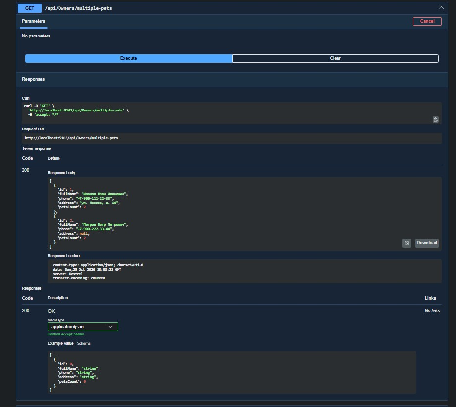
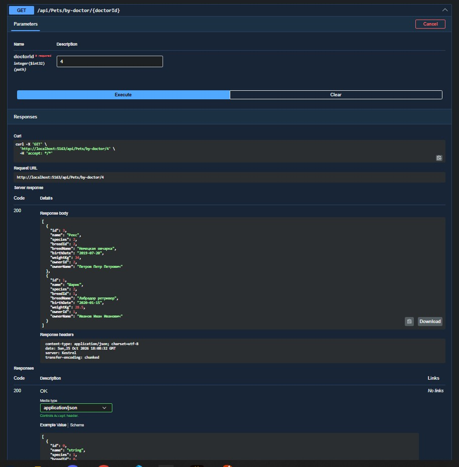
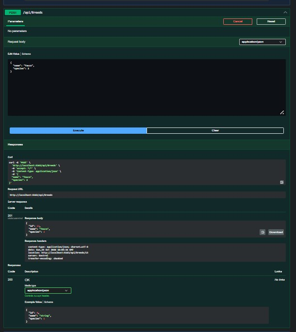
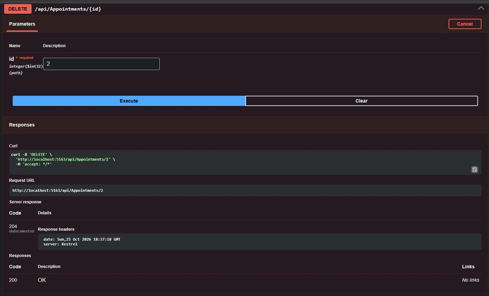

# Разработка корпоративных приложений

## Лабораторная работа №2: «Сервер»
**Тема:** Реализация серверного приложения с использованием REST API  
**Вариант:** №44 — «Ветеринарная клиника»

---

### Описание предметной области
В информационной системе ветеринарной клиники фиксируются данные о питомцах, их владельцах, ветеринарах и записях на прием:

* **Питомец (`Pet`):** кличка, биологический вид, порода, дата рождения, вес, владелец
* **Вид животного (`AnimalSpecies`):** перечисление видов животных
* **Порода (`Breed`):** справочник с привязкой к конкретному виду животного
* **Владелец (`Owner`):** ФИО, телефон, адрес, список питомцев
* **Ветеринарный врач (`Veterinarian`):** ФИО, номер паспорта, год рождения, стаж, специализация
* **Специализация (`Specialization`):** справочник с привязкой к профильному виду животного
* **Прием (`Appointment`):** дата и время, номер кабинета, признак повторного приема, ссылки на питомца и врача

---

### Реализованный функционал
1. Создан серверный проект `VetClinic.WebApi` на платформе ASP.NET Core
2. Реализован репозиторий `InMemoryRepository` для управления хранением данных в оперативной памяти
3. Разработаны DTO модели для разделения внутреннего доменного слоя и внешнего сетевого взаимодействия
4. Реализованы REST контроллеры с поддержкой полного набора CRUD операций:
   * Управление породами через `BreedsController`
   * Управление специализациями врачей через `SpecializationsController`
   * Управление владельцами через `OwnersController`
   * Управление питомцами через `PetsController`
   * Управление ветеринарами через `VeterinariansController`
   * Управление записями на прием через `AppointmentsController`
5. Реализованы эндпоинты для предоставления результатов аналитических запросов:
   * `GET /api/Veterinarians/by-species` — получение врачей по профильному виду животного
   * `GET /api/Pets/by-doctor/{doctorId}` — получение уникальных питомцев врача с сортировкой по кличке
   * `GET /api/Appointments/follow-up-count` — подсчет количества повторных приемов для выбранной породы
   * `GET /api/Owners/multiple-pets` — выборка владельцев с несколькими питомцами с сортировкой по ФИО
   * `GET /api/Appointments/by-room` — выборка приемов за указанный месяц в заданном кабинете
6. Подключена и настроена интерактивная документация Swagger UI

---

### Запуск приложения и тестов

Запуск веб-сервера:
```bash
dotnet run --project src/VetClinic.WebApi
```
Документация Swagger доступна по адресу [Текст ссылки](http://localhost:5163/swagger)

Запуск юнит-тестов:
```bash
dotnet test
```

---

### Результаты работы REST API







---
