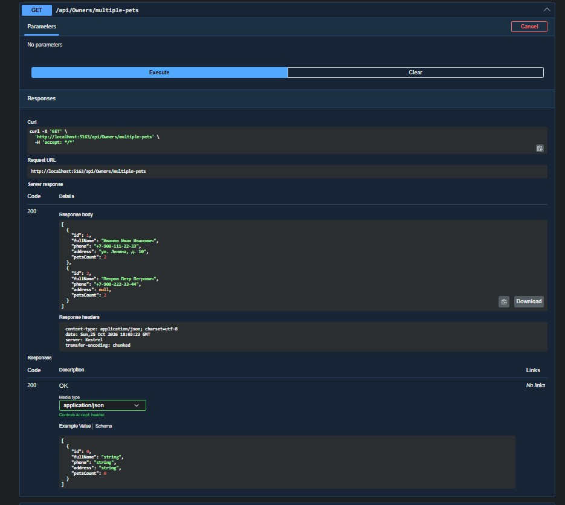
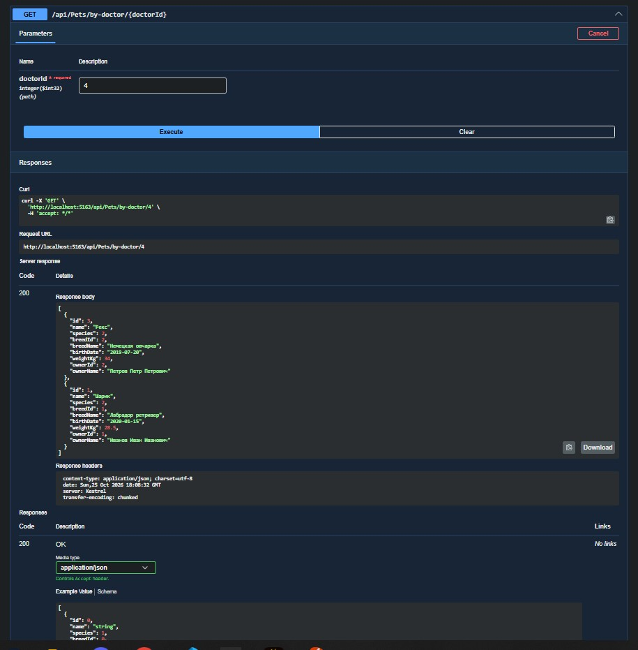
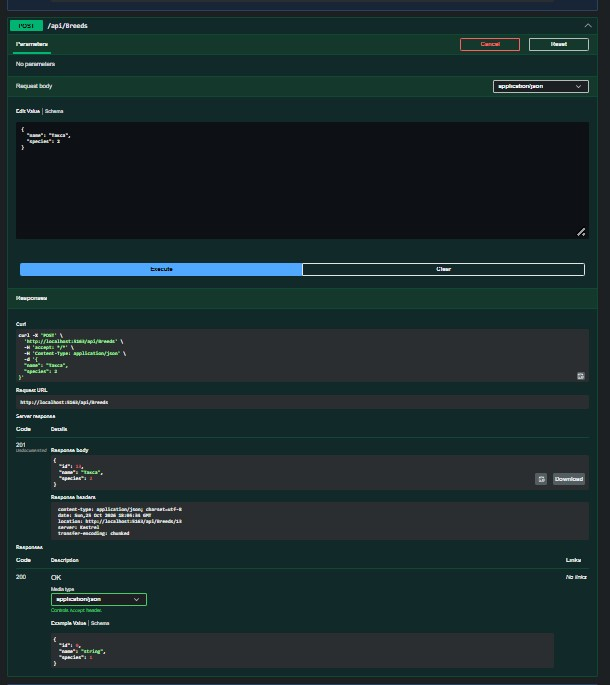
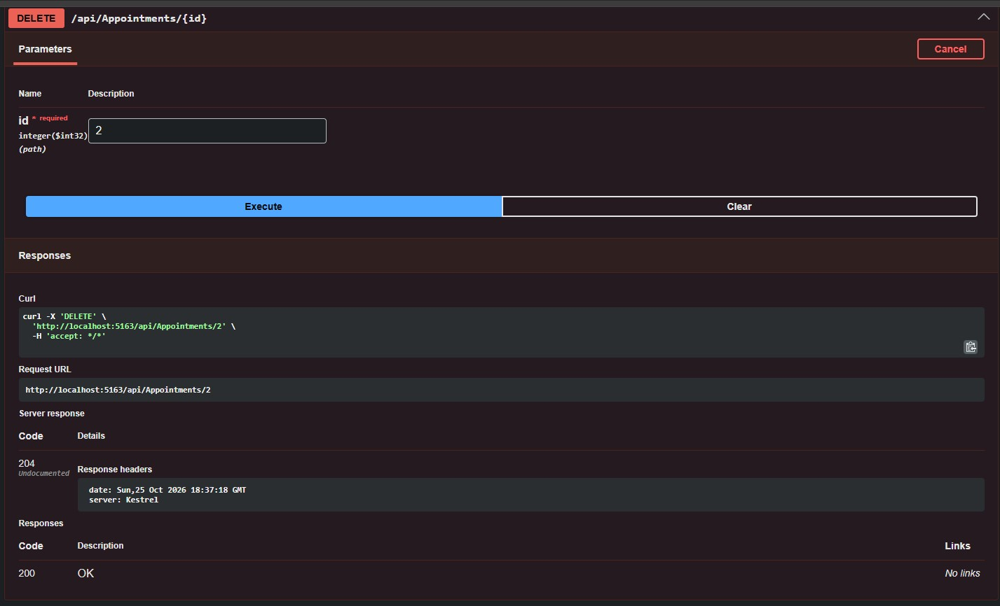

# Разработка корпоративных приложений

## Лабораторная работа №3 — ORM

Web API хранит данные в PostgreSQL через EF Core. Проект `VetClinic.Infrastructure.PostgreSql` содержит контекст, репозиторий и две миграции. `InitialCreate` создаёт шесть таблиц и внешние ключи, `SeedClinicData` загружает 62 демонстрационные записи из лабораторной №2. При запуске API применяет ожидающие миграции до обработки запросов.

Удаление записи, на которую ссылаются другие записи, возвращает HTTP 409. Например, перед удалением питомца нужно удалить его приёмы. Дата и время приёма хранятся по местному календарю клиники и передаются в формате `2026-09-10T10:00:00`.

### Запуск

Понадобятся .NET SDK 10 и запущенный Docker с поддержкой Linux-контейнеров. На Windows запустите [Docker Desktop](https://docs.docker.com/desktop/setup/install/windows-install/). Проверьте командой `docker info --format '{{.OSType}}'`, что Docker отвечает и выводит `linux`. Из корня репозитория выполните:

```powershell
dotnet dev-certs https --trust
dotnet run --project VetClinic/src/VetClinic.AppHost
```

Первую команду достаточно выполнить один раз для локального сертификата панели Aspire. Для входа в панель откройте полную ссылку из строки `Login to the dashboard at` в терминале. В неё уже включён токен. В панели будут видны ресурсы `postgres`, `vetclinic` и `webapi`. После запуска `webapi` откройте [Swagger](http://localhost:5163/swagger).

Если Aspire выводит `Container runtime 'docker' could not be found`, проверьте `Get-Command docker` **в том же окне PowerShell**, из которого запускаете AppHost. Если команда не находит Docker после установки, полностью закройте и заново откройте терминал или IDE. Для установки Docker Desktop на одного пользователя можно также добавить его путь в текущий сеанс PowerShell:

```powershell
$dockerBin = Join-Path $env:LOCALAPPDATA 'Programs\DockerDesktop\resources\bin'
$env:Path = "$dockerBin;$env:Path"
```

Если команда `docker` распознаётся, но не может подключиться к движку, запустите Docker Desktop и дождитесь его готовности. Затем перезапустите AppHost.

### Проверка

1. Выполните `GET /api/Breeds`. На чистой базе в ответе будет 12 пород.
2. Выполните `GET /api/Owners/multiple-pets`. В ответе будут Иванов и Петров, у каждого по два питомца.
3. Создайте породу через `POST /api/Breeds`, например с телом `{"name":"Такса","species":2}`. Запомните ID из ответа `201 Created`.
4. Остановите AppHost через Ctrl+C и запустите снова. `GET /api/Breeds/{id}` должен вернуть созданную породу. PostgreSQL хранит данные в Docker-томе между запусками.

Существующие unit-тесты используют in-memory репозитории. Их можно запустить без Docker:

```powershell
dotnet test VetClinic/VetClinic.slnx
```

## Лабораторная работа №2: «Сервер»
**Тема:** Реализация серверного приложения с использованием REST API  
**Вариант:** №44 — «Ветеринарная клиника»

---

### Описание предметной области
В информационной системе ветеринарной клиники фиксируются данные о питомцах, их владельцах, ветеринарах и записях на прием:

* **Питомец (`Pet`):** кличка, биологический вид, порода, дата рождения, вес, владелец
* **Вид животного (`AnimalSpecies`):** перечисление видов животных
* **Порода (`Breed`):** справочник с привязкой к конкретному виду животного
* **Владелец (`Owner`):** ФИО, телефон, адрес, список питомцев
* **Ветеринарный врач (`Veterinarian`):** ФИО, номер паспорта, год рождения, стаж, специализация
* **Специализация (`Specialization`):** справочник с привязкой к профильному виду животного
* **Прием (`Appointment`):** дата и время, номер кабинета, признак повторного приема, ссылки на питомца и врача

---

### Реализованный функционал
1. Создан серверный проект `VetClinic.WebApi` на платформе ASP.NET Core
2. Реализован репозиторий `InMemoryRepository` для управления хранением данных в оперативной памяти
3. Разработаны DTO модели для разделения внутреннего доменного слоя и внешнего сетевого взаимодействия
4. Реализованы REST контроллеры с поддержкой полного набора CRUD операций:
   * Управление породами через `BreedsController`
   * Управление специализациями врачей через `SpecializationsController`
   * Управление владельцами через `OwnersController`
   * Управление питомцами через `PetsController`
   * Управление ветеринарами через `VeterinariansController`
   * Управление записями на прием через `AppointmentsController`
5. Реализованы эндпоинты для предоставления результатов аналитических запросов:
   * `GET /api/Veterinarians/by-species` — получение врачей по профильному виду животного
   * `GET /api/Pets/by-doctor/{doctorId}` — получение уникальных питомцев врача с сортировкой по кличке
   * `GET /api/Appointments/follow-up-count` — подсчет количества повторных приемов для выбранной породы
   * `GET /api/Owners/multiple-pets` — выборка владельцев с несколькими питомцами с сортировкой по ФИО
   * `GET /api/Appointments/by-room` — выборка приемов за указанный месяц в заданном кабинете
6. Подключена и настроена интерактивная документация Swagger UI

---

### Результаты работы REST API







---
